# 阿柴快送 · 标杆建筑「海风庄 v2」质感跃升对比预览

- **线上固定可玩入口（PWA）**：https://perinchiang.github.io/shiba-delivery/
  - 左上角 `场景瞬移` 可直达：**`标杆建筑·海风庄全景`** / **`标杆建筑·外楼梯上二楼`** / **`标杆建筑·一楼门面近景`**

---

## 0. 方向 A 概念参考图

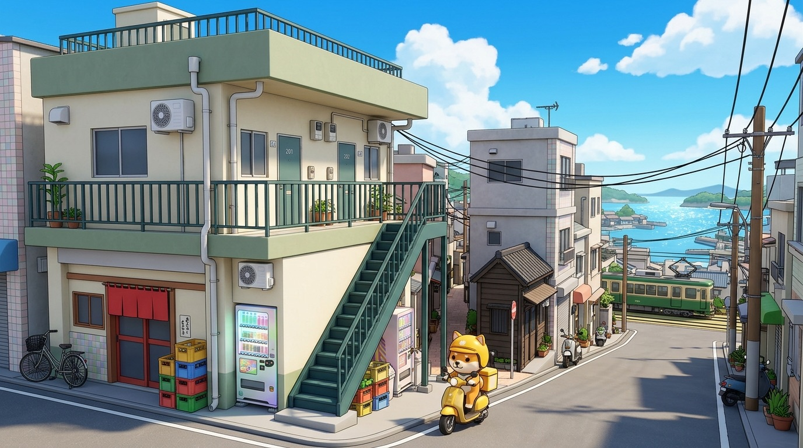

---

## 1. 全景对比（清晨 · v1 素模 vs v2 材质+贴图+烘焙 AO）

### 优化前（v1 · `0f0f630`）
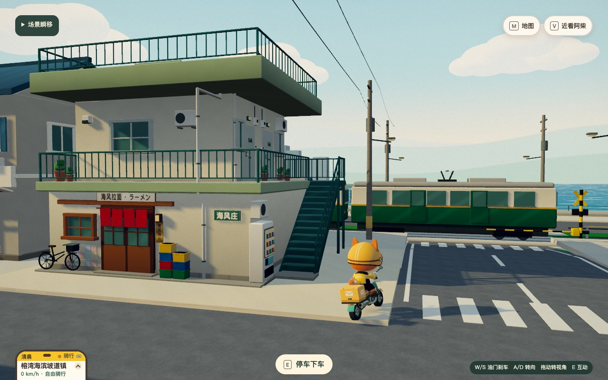

### 优化后（v2 · `3fe7028`）
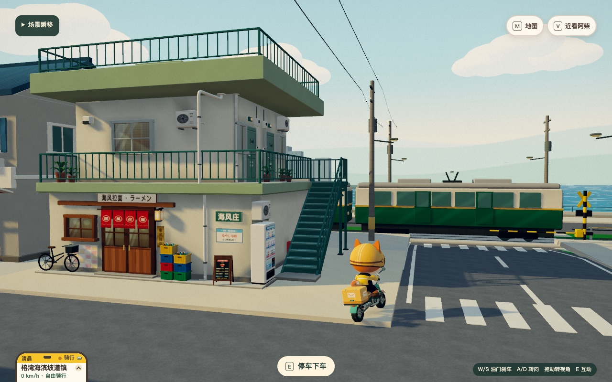

---

## 2. 一楼拉面店门面近景对比（v1 vs v2）

> 升级重点：四片印染布纹暖帘（`潮 風 拉 麺`）+ 杉木拉门木纹与黄铜把手 + 发光纸灯笼 + 粉彩釉面马赛克瓷砖 + 镂空可装玻璃瓶的塑料饮料筐 + 木质 A 字手绘菜单板 + 复古夏日海报 + 弧形弯头排水管。

### 优化前（v1）
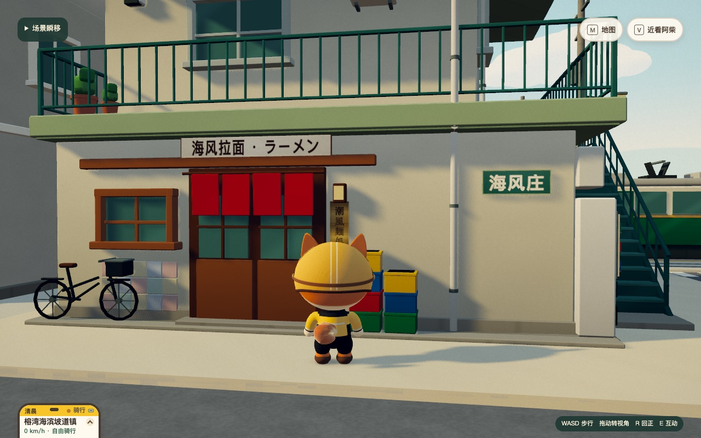

### 优化后（v2）
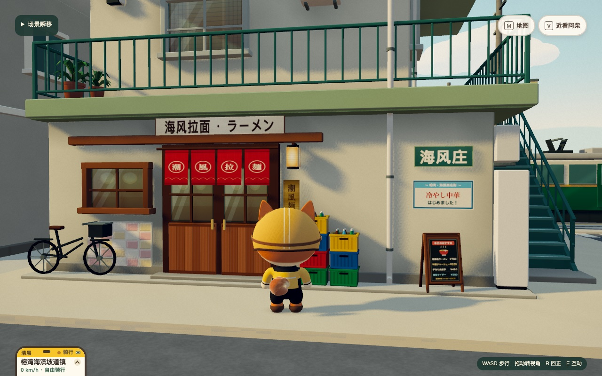

---

## 3. 二楼外楼梯与 201 / 202 走廊对比（v1 vs v2）

> 升级重点：真叶片 3D 盆栽（替代方块灌木）、带散热网罩/风扇叶/白色包扎冷媒管的空调外机、带猫眼与信箱凹线的海沫绿烤漆钢公寓门、带百叶纱帘层次与天光反光的玻璃窗、半光烤漆钢防滑楼梯踏步。

### 优化前（v1）
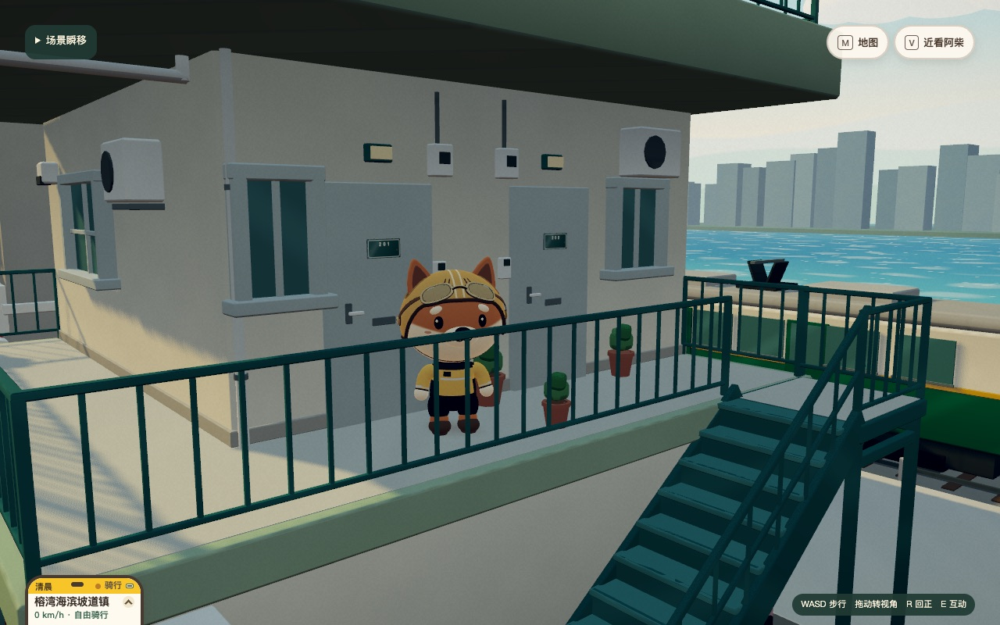

### 优化后（v2）
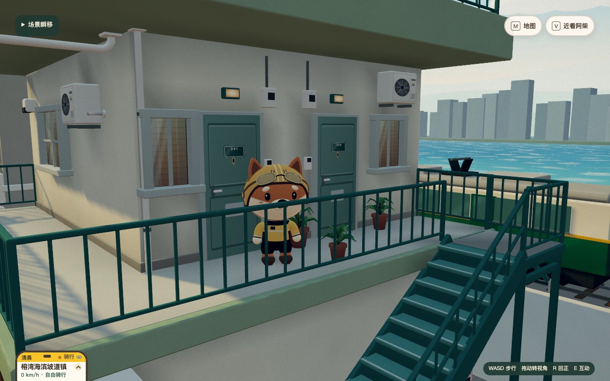

---

## 4. 傍晚 & 夜晚实机表现（v2）

### 傍晚全景（江之电过道口）
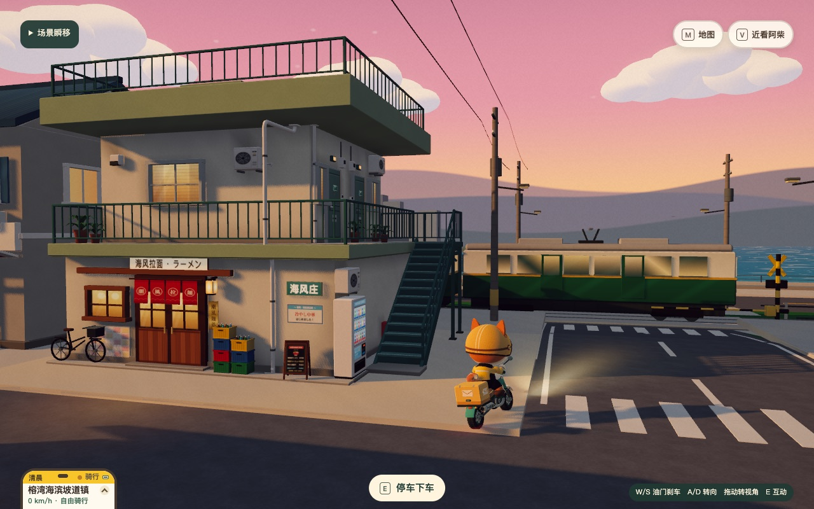

### 傍晚二楼走廊
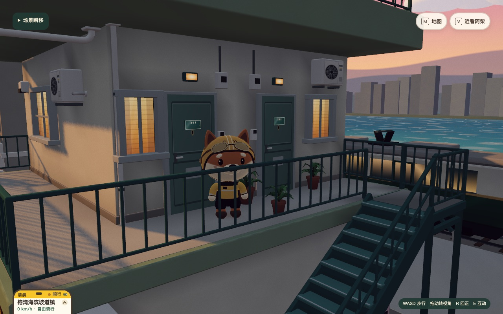

### 夜晚全景（防过曝彩色背光贩卖机 + 暖帘透光 + 暖光窗户）
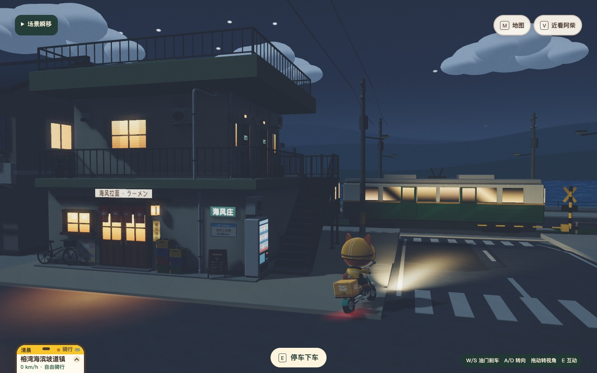

### 夜晚一楼门面近景
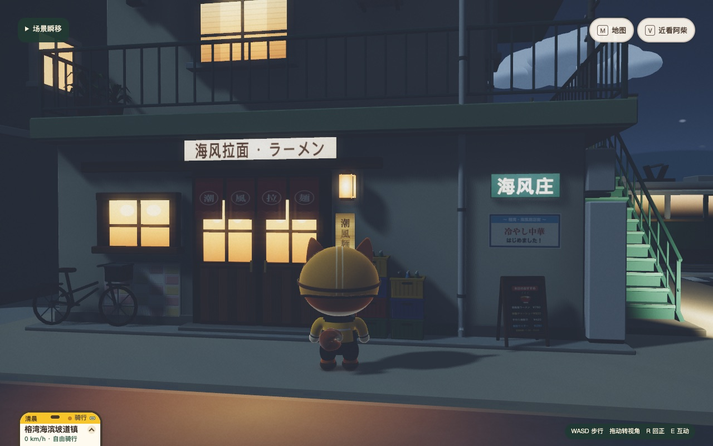
